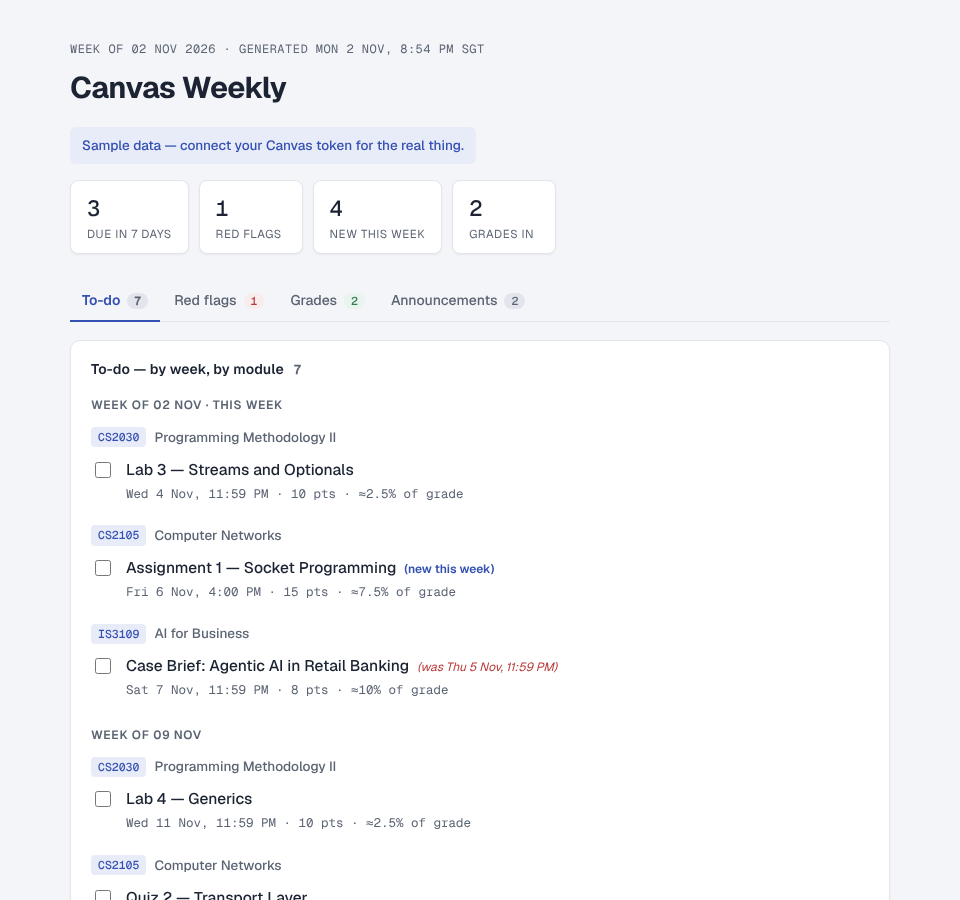

<h1 align="center">Canvas Weekly</h1>

<p align="center">A weekly report of your NUS Canvas deadlines, red flags, new grades and announcements, as one local web page.</p>

<p align="center">
  
</p>

<p align="center"><sub>The report rendered with <code>python3 canvas_report.py --demo</code>: built-in sample data, not a real account.</sub></p>

## Why

Canvas spreads deadlines, grades and announcements across every module. This pulls them into one page each Friday and marks what changed since the previous snapshot.

## What it does

Every Friday 8:00 am, pulls NUS Canvas and regenerates `index.html`, served at
**http://localhost:8787** (start with `./serve.sh`; localhost-only bind):

- **To-do** — every upcoming assignment as a tickable checklist, grouped by
  week and, within each week, by module. Anything that changed since the previous
  snapshot is bracketed inline: `(new this week)`, `(was Thu 21 Aug)`. New
  lecture files land at the bottom of this tab.
- **Red flags** — past due, not submitted, due within the last 45 days.
- **Grades** — scores released this week.
- **Announcements** — last 7 days across all modules.

Where a module uses weighted assignment groups in Canvas, each item also shows
its share of the final grade (e.g. `≈7.5% of grade`), computed as
`group weight × item points ÷ group total points`.

## Setup

1. Canvas → Account → Settings → **+ New Access Token**, then:
   ```sh
   echo '<token>' > ~/.canvas_token && chmod 600 ~/.canvas_token
   ```
2. Test a live run:
   ```sh
   python3 canvas_report.py && open http://localhost:8787
   ```
   (`--demo` renders sample data without a token. Keep `./serve.sh` running
   in a spare terminal, or just `open index.html` directly.)
3. The Friday schedule is a launchd job (`com.canvasreporting.weekly.plist`,
   installed in `~/Library/LaunchAgents`). Re-install after edits with:
   ```sh
   cp com.canvasreporting.weekly.plist ~/Library/LaunchAgents/
   launchctl unload ~/Library/LaunchAgents/com.canvasreporting.weekly.plist 2>/dev/null
   launchctl load ~/Library/LaunchAgents/com.canvasreporting.weekly.plist
   ```

## How it works

- `canvas_report.py` — fetches courses, assignment groups (for grade
  weights), assignments (+ your submissions), module files, and announcements
  via the Canvas REST API (stdlib only, no pip installs); diffs against the
  previous snapshot in `snapshots/`; renders `index.html`.
- `run_weekly.sh` — runs the fetch, then opens the localhost page (falls
  back to the file if the server isn't running). If the fetch fails (or
  there's no token) it keeps the last good report.
- Ticks and the active tab live in your browser's localStorage, so they
  survive the weekly regeneration.

The token (`~/.canvas_token`, chmod 600,
never committed) is sent only to the `base_url` in `config.json`
(`canvas.nus.edu.sg` by default), and the report and snapshots are gitignored
local files. The page itself loads its fonts from Google Fonts. The Mac must be awake at
8 am Friday for launchd to fire (it catches up at next wake otherwise).

## Deploying to Vercel (later)

The output is a single static `index.html`, so a Vercel deploy is just
`vercel --prod` from this folder (or pointing a Vercel project at the repo)
— no config needed. Two things before doing it with real data:

1. `index.html` is gitignored on purpose: it contains your assignments and
   grades. A git-connected Vercel project won't see it; deploy with the CLI,
   or commit it consciously.
2. A Vercel URL is public by default. Put Vercel's password protection or
   `x-vercel-protection` in front, or accept that anyone with the URL sees
   your deadlines and grades. The Friday job can then end with
   `vercel --prod --yes` to auto-redeploy.
